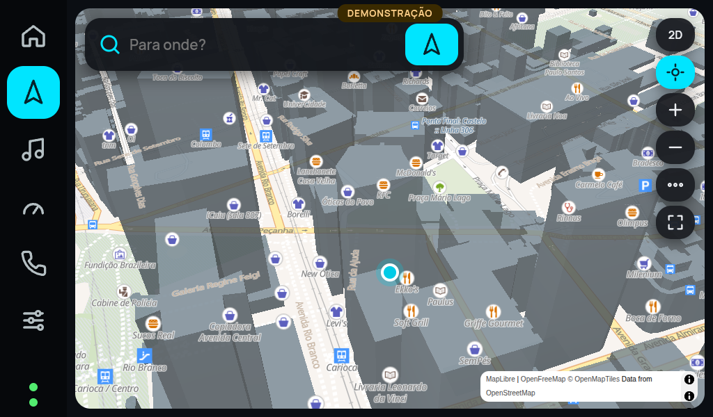

# AD Car Aura 2.10.0 — MapLibre 3D TESTE
Data: 01/11/2026. **Experimental: não é a atualização oficial.**

[Baixar APK](AD-Car-Aura-2.10.0-3D-TEST.apk) · [SHA-256](AD-Car-Aura-2.10.0-3D-TEST.sha256)

- Versão: `2.10.0-3d-test`; versionCode: `21`.
- Pacote preservado: `br.com.adcomintegrada.adcar.aura`.
- minSdk 26 (Android 8.0+); alvo principal: central Android 8.1.
- Tamanho: 441633 bytes.
- SHA-256: `fce824fe6827fe120a2b146ff70d58b9dcc03f919aa1b91bef02edae540cdc99`.
- Certificado SHA-256: `fce556d5897b98ed90fcfef1aa289c2cd5def3cb99a5d585857e5c6de2f796dd`.
- Certificado comparado automaticamente com o APK estável 2.8.0: idêntico.
- Fonte: [branch experimental](https://github.com/andredeveza/Renegade-Cockpit/tree/feature/aura-maplibre-3d), commit `699ab616e096a1c82f1064a79aa617690886a500`.
- [PR em rascunho](https://github.com/andredeveza/Renegade-Cockpit/pull/1).
- [Build e testes aprovados](https://github.com/andredeveza/Renegade-Cockpit/actions/runs/41298933063).

## O que foi implementado

MapLibre GL JS 4.7.1 empacotado no APK (JS, CSS e licença; integridade SHA-512 verificada), câmera inclinada a 50°, botão 2D/3D, acompanhamento da posição recebida do GPS Android, rotação com suavização do rumo e congelamento abaixo de 6 km/h, zoom conforme velocidade e recentralização.

As rotas existentes do BRouter/OSRM são desenhadas no novo motor. O mapa usa OpenFreeMap online, sem chave. Edifícios usam polígonos e atributos de altura fornecidos pelo mapa; cobertura/precisão variam e as alturas podem ser derivadas pelo provedor.

Fallback automático ao Leaflet por incompatibilidade gráfica, falha de inicialização, perda de contexto, erros repetidos de dados ou timeout. Home, tela de mapa, overlays e bridge Java preservados. Java/manifesto/MediaSession/OBD/Ponte/FM/volume não foram alterados.

## Como instalar e testar

1. Com o carro estacionado, instale este APK **por cima** do Aura, sem desinstalar.
2. Se Android recusar a atualização, pare e informe o erro. Não apague dados.
3. Abra o mapa em modo **Online**, com internet, e toque **3D**.
4. Teste mapa/home, arrastar/recentralizar, 2D/3D, GPS e rota BRouter, música/volume e retorno aos aplicativos.
5. Se houver falha gráfica, o mapa retorna a 2D. Consulte Ajustes > Sobre para diagnóstico.
6. Selecione Offline para testar o MBTiles RJ e BRouter sem internet.

O APK não usa a posição simulada da captura abaixo; a demonstração foi ativada somente pelo teste de navegador.

## Evidências e limites

| Verificação | Resultado |
|---|---|
| Sete testes Node de GPS, rumo, zoom, coordenadas e ciclo de vida | APROVADO |
| Sintaxe JavaScript | APROVADO |
| Canvas MapLibre real em Chromium com GPU por software | APROVADO |
| GPS simulado: perda/recuperação, home/mídia, fallback gráfico | APROVADO |
| Botão 3D dentro de 800×480, 1024×600 e 1280×720 | APROVADO |
| Estilo online real do Rio e camada de edifícios | APROVADO em desktop; imagem abaixo |
| Compilação Android release | APROVADO |
| Assinatura igual à 2.8.0; checksum do APK baixado | APROVADO |
| Android 8.1 real, WebView/GPU da KOWAN, FPS/RAM/temperatura | NÃO TESTADO |
| GPS/BRouter/OBD/Ponte/música/rádio no veículo com esta versão | NÃO TESTADO |
| Mapa 3D offline do RJ | NÃO IMPLEMENTADO |

**O offline atual continua raster 2D.** BRouter e seus segmentos rd5 continuam separados. A preparação para offline vetorial está documentada, mas ainda precisa de pacote regional, estilo/fontes/sprites locais e endpoint vetorial. Não há download irrestrito de tiles públicos.

Esta é a primeira POC, ainda sem equivalência completa ao Nebula. Recálculo robusto, instruções viárias/voz, busca offline e desempenho na central exigem trabalho/validação adicional. A lógica preexistente de instruções BRouter por geometria permanece aproximada.

## Arquitetura e retorno

GL JS foi escolhido para integrar o slot atual da home e manter os estados de navegação/bridge sem mudança nativa. MapLibre Native é a alternativa caso a WebView não suporte a POC; não foi implementado ou medido neste ciclo.

Retorno imediato: botão 2D ou modo Offline. Android normalmente impede instalar versionCode 20 sobre 21; retorno binário mantendo dados exige recompilar a base com versionCode maior e a mesma assinatura. Não recomendar desinstalação.

**`aura-latest.json` continua na 2.8.0/versionCode 16. Nenhuma promoção estável foi feita.**

## Captura de teste desktop — posição simulada

Referências: https://openfreemap.org/quick_start/ · https://maplibre.org/maplibre-native/android/api/
